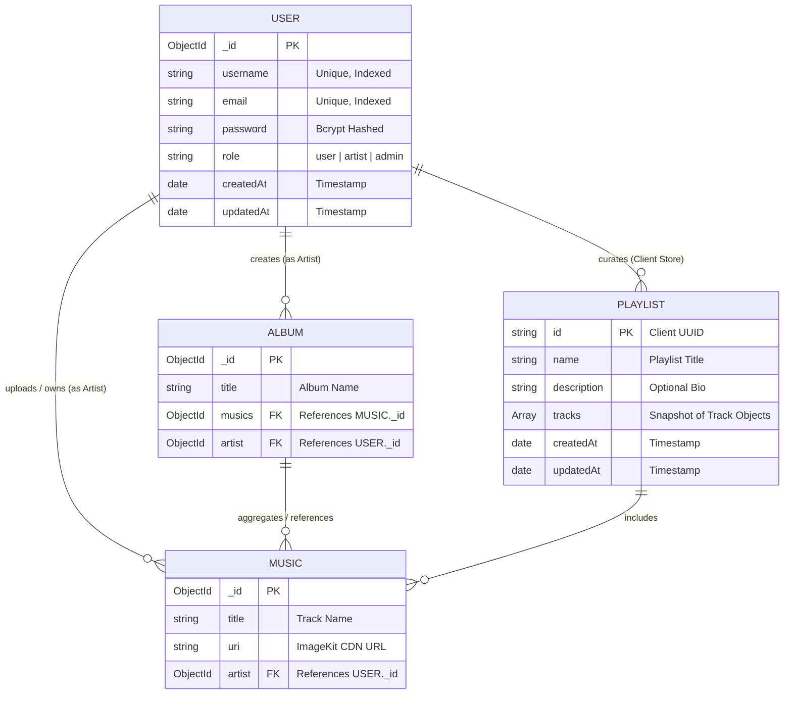
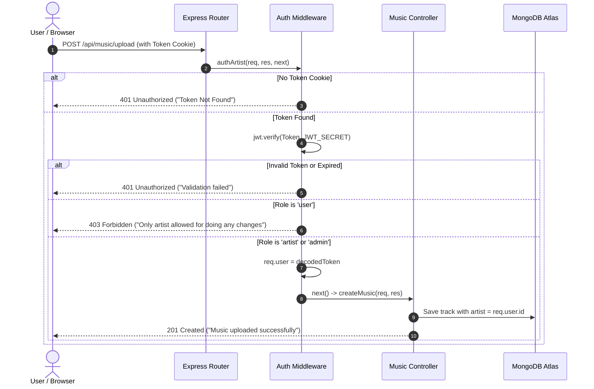
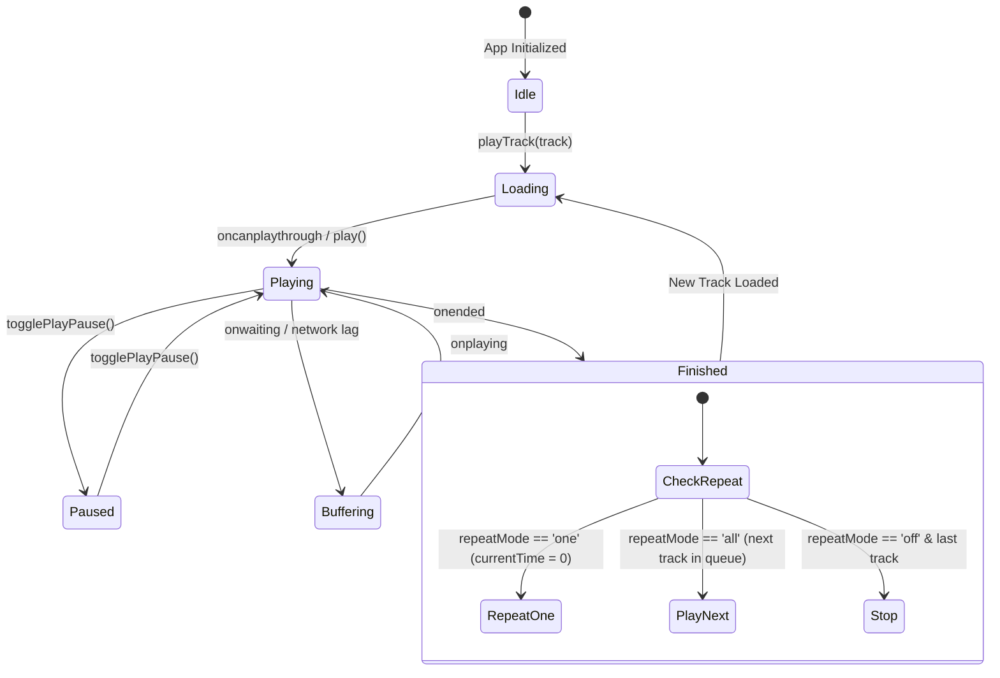

# 🎵 Melodify — Cloud Music Streaming & Audio Ecosystem

<div align="center">


[](https://nextjs.org/)
[](https://react.dev/)
[](https://nodejs.org/)
[](https://www.mongodb.com/)
[](https://www.typescriptlang.org/)
[](https://imagekit.io/)
[](https://opensource.org/licenses/MIT)
[](https://github.com/)

> **"Your music, your mood."**  
> An enterprise-grade, high-performance music streaming web application and creator studio. Built from the ground up featuring low-latency global audio streaming, role-based access control (RBAC), interactive audio visualizer and queue management, and an automated ImageKit CDN upload pipeline.

[Explore Documentation](#-table-of-contents) • [Live Demo Guide](file:///c:/Antigravity/backendNew/Melodify/deployeGuide.md) • [Report Bug](https://github.com/) • [Request Feature](https://github.com/)

</div>

---

## 📑 Table of Contents

1. [Project Overview & Vision](#-project-overview--vision)
2. [Key Highlights & Capabilities](#-key-highlights--capabilities)
3. [System Architecture & Data Flow](#-system-architecture--data-flow)
4. [Technology Stack](#-technology-stack)
5. [Database Architecture & Entity Relationship (ER) Diagram](#-database-architecture--entity-relationship-er-diagram)
6. [API Specification & Endpoints](#-api-specification--endpoints)
7. [Core Business Logics & Implementation Details](#-core-business-logics--implementation-details)
   - [7.1 Role-Based Access Control (RBAC) & Authentication Flow](#71-role-based-access-control-rbac--authentication-flow)
   - [7.2 Media Storage Pipeline (Multer + ImageKit CDN)](#72-media-storage-pipeline-multer--imagekit-cdn)
   - [7.3 Zero-CORS Next.js Reverse Proxy & Cookie Architecture](#73-zero-cors-nextjs-reverse-proxy--cookie-architecture)
   - [7.4 Continuous HTML5 Audio Engine & State Machine](#74-continuous-html5-audio-engine--state-machine)
   - [7.5 Client-Side Playlist & Favorites Storage Layer](#75-client-side-playlist--favorites-storage-layer)
8. [UI/UX Design System: Obsidian & Neon](#-uiux-design-system-obsidian--neon)
9. [Repository Structure](#-repository-structure)
10. [Local Development & Setup Guide](#-local-development--setup-guide)
11. [Testing & Quality Assurance](#-testing--quality-assurance)
12. [Cloud Deployment & Production Hosting](#-cloud-deployment--production-hosting)
13. [Product Roadmap & Future Planning](#-product-roadmap--future-planning)
14. [Author & Maintainers](#-author--maintainers)
15. [Licenses](#-licenses)

---

## 🌟 Project Overview & Vision

**Melodify** is a complete, full-stack cloud music platform designed to bridge the gap between music listeners and independent audio creators. Modern audio streaming services often suffer from heavy vendor lock-in, slow cold-start performance, and opaque creator upload tools. Melodify addresses this by providing:

1. **For Listeners**: A lightning-fast, ad-free listening experience featuring instant playback, persistent audio bar across route transitions, customizable playlists, smart queue manipulation (shuffle, repeat modes), and deep search discovery.
2. **For Artists & Creators**: A dedicated Creator Studio enabling drag-and-drop audio file uploads, automatic CDN transcoding and optimization, track metadata tagging, and discography/album creation.
3. **For Developers & DevOps**: Clean separation of concerns with a decoupled **Express.js** backend microservice and a **Next.js 16 App Router** frontend, containerized ready, automated integration test suites, and zero-cost cloud deployment paths.

---

## ⚡ Key Highlights & Capabilities

### 🎧 Audio & Listening Experience
- **Persistent Global Player**: HTML5 Audio singleton that stays seamlessly active across client-side page transitions without stuttering or re-buffering.
- **Dynamic Queue Management**: Add to queue, play next, reorder tracks, shuffle queue, and toggle repeat modes (`off`, `all`, `one`).
- **Interactive Scrubber & Volume State**: Precise millisecond seeking with live audio progress indicators, volume slider, and instant mute toggle.
- **Smart Local Favorites & History**: Liked songs and listening history cached client-side with instant UI reactivity and zero latency.

### 🎨 Discovery & Library
- **Obsidian & Neon Glassmorphic UI**: Premium dark aesthetic built with bespoke Vanilla CSS tokens, glow accents, and responsive layout breakpoints.
- **Deep Search & Filtering**: Multi-dimensional search across track titles, artist usernames, genres, and albums.
- **Album Discs & Tracklists**: Visual LP vinyl presentation with one-click "Play All" album playback.
- **Custom Playlists**: Create, edit, rename, and manage custom playlists on demand.

### 🎙️ Creator & Artist Studio
- **Role-Based Creator Portal**: Dedicated access for users with `artist` or `admin` roles to publish songs and albums.
- **Cloud Media Upload Pipeline**: Direct streaming of multipart audio (`.mp3`, `.wav`) to ImageKit global CDN with metadata binding in MongoDB.
- **Album Builder**: Bundle uploaded tracks into cohesive albums linked to the artist's discography.

---

## 🏗️ System Architecture & Data Flow

Melodify employs a decoupled, cloud-native microservice architecture designed for high availability and zero cross-origin friction:

```mermaid
flowchart TD
    subgraph Client["🖥️ User Interface (Browser & Mobile)"]
        UI["Next.js 16 Web App<br/>React 19 Server/Client Components"]
        AudioEngine["HTML5 Audio Engine<br/>Singleton State Machine"]
        LocalStore["Local Storage Cache<br/>(Playlists, Favorites, Preferences)"]
        UI <--> AudioEngine
        UI <--> LocalStore
    end

    subgraph Edge["⚡ Vercel Edge Network / Reverse Proxy"]
        SSR["Server-Side Render Engine"]
        Proxy["Next.js API Rewrites Proxy<br/>/api/* ➔ Backend URL"]
        UI -->|Page Requests| SSR
        UI -->|API Requests (/api/...)| Proxy
    end

    subgraph BackendCluster["🚀 Express.js API Cluster (Render / Koyeb)"]
        Router["Express 5 Router"]
        AuthMid["JWT Auth Middleware<br/>(Role Verification: User / Artist / Admin)"]
        MulterMid["Multer Memory Buffer"]
        AuthCtrl["Auth Controller<br/>(Register, Login, Cookie Engine)"]
        MusicCtrl["Music & Album Controller"]
        
        Proxy -->|Forwarded API Requests| Router
        Router --> AuthCtrl
        Router --> AuthMid
        AuthMid --> MulterMid
        MulterMid --> MusicCtrl
    end

    subgraph CloudInfra["☁️ Cloud Infrastructure & Storage"]
        Mongo[("🍃 MongoDB Atlas<br/>Users, Musics, Albums")]
        ImageKitCDN["🖼️ ImageKit CDN<br/>Global Edge Audio & Cover Storage"]
        
        AuthCtrl <-->|Mongoose Queries| Mongo
        MusicCtrl <-->|Mongoose Queries| Mongo
        MusicCtrl -->|Upload Stream| ImageKitCDN
        AudioEngine -->|Direct Audio Stream (HTTPS)| ImageKitCDN
    end
```

---

## 🛠️ Technology Stack

| Domain | Technology | Version | Purpose in Melodify |
|---|---|---|---|
| **Frontend Framework** | **Next.js** | `16.4.1` | App Router, SSR, Turbopack, Server Actions & dynamic routing |
| **UI Library** | **React** | `19.3.1` | Declarative UI state, Concurrent Mode, context providers |
| **Language** | **TypeScript** | `7.0.2` | End-to-end static typing, interfaces, and compile-time safety |
| **Styling & Tokens** | **Vanilla CSS** | Modern CSS3 | Custom Obsidian design tokens, glassmorphism, responsive grid |
| **Iconography** | **Lucide React** | `1.57.0` | High-fidelity, lightweight SVG UI icons |
| **Backend Runtime** | **Node.js** | `v20+ / v22` | Asynchronous event-driven JavaScript server runtime |
| **Backend Framework** | **Express.js** | `5.2.1` | RESTful API routing, middleware chaining, and error handling |
| **Database** | **MongoDB Atlas** | `v7.0+` | NoSQL document database for scalable relational-like music metadata |
| **ODM** | **Mongoose** | `9.10.4` | Object Data Modeling, schema validation, population hooks |
| **Authentication** | **JWT & BcryptJS** | `jsonwebtoken 9.0.3` / `bcryptjs 3.0.3` | Cryptographic password hashing and stateless token signing |
| **File Processing** | **Multer** | `2.4.0` | Memory-based multipart/form-data upload handling |
| **Cloud CDN** | **@imagekit/nodejs** | `7.12.1` | Cloud audio and artwork storage with global CDN edge delivery |
| **Environment Config** | **dotenv** | `18.0.5` | Twelve-factor app configuration and secret management |
| **Cookie Parser** | **cookie-parser**| `1.4.7` | HTTP-only cookie extraction and session management |

---

## 📊 Database Architecture & Entity Relationship (ER) Diagram

The data model is engineered in MongoDB via Mongoose schemas located in [backend/src/models/](file:///c:/Antigravity/backendNew/Melodify/backend/src/models/).



### Schema Definitions

#### 1. User Schema ([backend/src/models/user.model.js](file:///c:/Antigravity/backendNew/Melodify/backend/src/models/user.model.js))
- `username`: String (required, unique, trimmed).
- `email`: String (required, unique, lowercased).
- `password`: String (required, 10-round bcrypt hash).
- `role`: String enum (`['user', 'artist', 'admin']`, default: `'user'`).
- Timestamps: Automatically tracks `createdAt` and `updatedAt`.

#### 2. Music Schema ([backend/src/models/music.model.js](file:///c:/Antigravity/backendNew/Melodify/backend/src/models/music.model.js))
- `title`: String (required, track display name).
- `uri`: String (required, direct HTTPS streaming URL provided by ImageKit).
- `artist`: ObjectId (required, references `user` collection with auto-populate capability).

#### 3. Album Schema ([backend/src/models/album.model.js](file:///c:/Antigravity/backendNew/Melodify/backend/src/models/album.model.js))
- `title`: String (required, album name).
- `musics`: ObjectId / Array of ObjectIds (references `music` collection).
- `artist`: ObjectId (required, references `user` collection).

---

## 🔌 API Specification & Endpoints

All backend routes are exposed through [backend/src/app.js](file:///c:/Antigravity/backendNew/Melodify/backend/src/app.js) with standard HTTP status codes.

### Authentication Endpoints (`/api/auth`)

| Method | Endpoint | Access | Request Payload | Success Code | Description |
|---|---|---|---|---|---|
| `POST` | `/api/auth/register` | Public | `{ username, email, password, role? }` | `201 Created` | Registers user, hashes password, sets `Token` cookie, returns user object. |
| `POST` | `/api/auth/login` | Public | `{ username \| email, password }` | `200 OK` | Validates credentials, signs JWT, sets `Token` cookie. |
| `POST` | `/api/auth/logout` | Public | None | `200 OK` | Clears `Token` cookie, ends session. |

### Music & Album Endpoints (`/api/music`)

| Method | Endpoint | Access | Headers / Form Data | Success Code | Description |
|---|---|---|---|---|---|
| `POST` | `/api/music/upload` | **Artist / Admin** | `multipart/form-data`<br/>Fields: `music` (file), `title`, `uri` | `201 Created` | Uploads audio buffer to ImageKit, creates track entry in MongoDB. |
| `POST` | `/api/music/album` | **Artist / Admin** | `application/json`<br/>`{ title, musics: string[] }` | `201 Created` | Creates an album referencing music IDs by authenticated artist. |
| `GET` | `/api/music` | **User / Artist / Admin** | None | `200 OK` | Fetches catalog of songs with populated artist profiles (limit: 20). |
| `GET` | `/api/music/albums` | **User / Artist / Admin** | None | `200 OK` | Fetches all albums with populated artist information. |
| `GET` | `/api/music/albums/:albumId` | **User / Artist / Admin** | Param: `albumId` | `200 OK` | Fetches single album details and its associated tracklist. |
| `GET` | `/` | Public | None | `200 OK` | Liveness health check returning `Melodify Backend is running 🚀`. |

---

## 🧠 Core Business Logics & Implementation Details

### 7.1 Role-Based Access Control (RBAC) & Authentication Flow

Melodify secures endpoints with tiered authorization using signed JSON Web Tokens (JWT) stored in HTTP cookies:



Implemented in [backend/src/middlewares/auth.middleware.js](file:///c:/Antigravity/backendNew/Melodify/backend/src/middlewares/auth.middleware.js):
- **`authUser`**: Permits registered users, artists, and admins to browse and stream music.
- **`authArtist`**: Restricts sensitive creation routes (`/upload`, `/album`) strictly to users with `artist` or `admin` roles.

### 7.2 Media Storage Pipeline (Multer + ImageKit CDN)

Instead of storing large media files locally or directly in MongoDB, Melodify integrates a cloud CDN pipeline:
1. **Memory Buffering**: [backend/src/routes/music.routes.js](file:///c:/Antigravity/backendNew/Melodify/backend/src/routes/music.routes.js) uses `multer.memoryStorage()`. Incoming audio streams are kept in RAM buffers without writing temporary files to the disk.
2. **Base64 Transcoding & CDN Upload**: [backend/src/services/storage.service.js](file:///c:/Antigravity/backendNew/Melodify/backend/src/services/storage.service.js) uploads the buffer to ImageKit under the organized folder path `yt-complete-backend/melodify/music`.
3. **Unique Timestamped Naming**: Every track is saved with a deterministic prefix `music_${Date.now()}` ensuring zero filename collisions.
4. **Metadata Preservation**: The resulting high-speed HTTPS CDN URI is returned and persisted in MongoDB.

### 7.3 Zero-CORS Next.js Reverse Proxy & Cookie Architecture

In modern web development, hosting the frontend on `melodify.vercel.app` and the backend on `melodify-backend.onrender.com` often results in blocked cross-origin cookies. Melodify eliminates this by leveraging **Next.js Rewrites** in [frontend/next.config.js](file:///c:/Antigravity/backendNew/Melodify/frontend/next.config.js):

```javascript
// frontend/next.config.js
module.exports = {
  async rewrites() {
    const backendUrl = process.env.BACKEND_INTERNAL_URL 
      || process.env.NEXT_PUBLIC_API_BASE_URL 
      || 'http://localhost:3000';
    return [
      {
        source: '/api/:path*',
        destination: `${backendUrl}/api/:path*`,
      },
    ];
  },
};
```

**Benefits**:
- Requests sent to `/api/auth/login` are treated as **same-origin** by the browser.
- The `Token` cookie is stored directly on the frontend domain.
- No third-party cookie restrictions in Chrome, Safari, or Brave.

### 7.4 Continuous HTML5 Audio Engine & State Machine

The audio engine in [frontend/contexts/PlayerContext.tsx](file:///c:/Antigravity/backendNew/Melodify/frontend/contexts/PlayerContext.tsx) manages playback state across all client pages:



**Key Player Engine Features**:
- **Race-Condition Protection**: Rejects stale play events if the user rapidly switches tracks.
- **Audio Pre-buffering**: Handles `preload="auto"` and dynamic volume fades.
- **Persistent Local State**: Automatically remembers user volume preference and last played track.

### 7.5 Client-Side Playlist & Favorites Storage Layer

To ensure instant interaction and zero database read delays for simple actions:
- **Favorites**: Stored under localStorage key `melodify_favorites`. Allows instant toggling with optimistic UI updates.
- **Custom Playlists**: Managed under `melodify_playlists`. Users can assemble custom playlists from any track in the catalog, persisted across browser reloads.

---

## 🎨 UI/UX Design System: Obsidian & Neon

Melodify features a custom Vanilla CSS design system specified in [frontend/app/globals.css](file:///c:/Antigravity/backendNew/Melodify/frontend/app/globals.css):

```css
:root {
  --bg-primary: #0a0b0e;        /* Deep obsidian space */
  --bg-surface: #12141a;        /* Elevated card background */
  --bg-glass: rgba(18, 20, 26, 0.75); /* Frosted glassmorphism */
  --accent-neon: #a855f7;       /* Electric violet primary */
  --accent-cyan: #06b6d4;       /* Neon cyan secondary */
  --accent-emerald: #10b981;    /* Vibrant playback indicator */
  --text-main: #f8fafc;         /* High-contrast crisp white */
  --text-muted: #94a3b8;        /* Soft slate metadata text */
  --border-subtle: rgba(255, 255, 255, 0.08);
}
```

### Aesthetic Standards
- **Glassmorphism**: Backdrop blur filters (`backdrop-filter: blur(16px)`) applied to navigation bars, modals, and the persistent audio player.
- **Micro-Animations**: Hover elevations, pulse rings on active playing tracks, smooth track progress bars, and glowing neon accents.
- **Fluid Layout**: Responsive from ultra-wide 4K monitors down to 360px mobile viewports with collapsible navigation drawers.

---

## 📂 Repository Structure

```
Melodify/
├── backend/                       # Express.js REST API Server
│   ├── .env.example               # Template for environment variables
│   ├── package.json               # Backend dependencies & npm scripts
│   ├── server.js                  # Entrypoint, DB bootstrap & port listener
│   ├── src/
│   │   ├── app.js                 # Express app configuration & middleware
│   │   ├── controllers/
│   │   │   ├── auth.controller.js  # User registration, login, logout
│   │   │   └── music.controller.js # Audio uploads, albums, queries
│   │   ├── db/
│   │   │   └── db.js              # MongoDB Mongoose connection handler
│   │   ├── middlewares/
│   │   │   └── auth.middleware.js  # JWT verification (authUser, authArtist)
│   │   ├── models/
│   │   │   ├── album.model.js     # Album Mongoose schema
│   │   │   ├── music.model.js     # Music track Mongoose schema
│   │   │   └── user.model.js      # User account Mongoose schema
│   │   ├── routes/
│   │   │   ├── auth.routes.js     # /api/auth routes
│   │   │   └── music.routes.js    # /api/music routes
│   │   └── services/
│   │       └── storage.service.js # ImageKit SDK cloud upload service
│   └── public/                    # Static backend assets
│
├── frontend/                      # Next.js 16 Web Application
│   ├── .env.example               # Frontend environment template
│   ├── package.json               # Frontend dependencies & Next.js scripts
│   ├── next.config.js             # API proxy rewrites & image domains
│   ├── tsconfig.json              # Strict TypeScript compiler options
│   ├── app/                       # Next.js App Router directory
│   │   ├── globals.css            # Obsidian & Neon global design system
│   │   ├── layout.tsx             # Root layout wrapping Context Providers
│   │   ├── page.tsx               # Home Page (Hero, Trending, Albums)
│   │   ├── discover/page.tsx      # Moodboards, genre playlists, discoveries
│   │   ├── search/page.tsx        # Multi-attribute instant search engine
│   │   ├── library/page.tsx       # User liked songs & listening history
│   │   ├── playlists/             # Playlists overview & dynamic [id] view
│   │   ├── albums/                # Albums catalog & dynamic vinyl [id] view
│   │   ├── artists/               # Artist discography & profiles
│   │   ├── upload/page.tsx        # Creator Studio audio upload form
│   │   ├── login/page.tsx         # Account login portal
│   │   ├── register/page.tsx      # Account registration portal
│   │   ├── error.tsx              # Error boundary with auto-recovery
│   │   ├── loading.tsx            # Fluid suspense skeleton loader
│   │   └── not-found.tsx          # 404 handler page
│   ├── components/                # Modular UI Components
│   │   ├── layout/                # Sidebar, Navbar, MobileNav
│   │   ├── music/                 # TrackCard, TrackList, AlbumCard, ArtistCard
│   │   ├── player/                # AudioPlayer, ProgressBar, Volume, QueueDrawer
│   │   └── ui/                    # Button, Input, Modal, Badge, Toast
│   ├── contexts/                  # React Context State Machines
│   │   ├── AuthContext.tsx        # Authentication session & user state
│   │   ├── PlayerContext.tsx      # Audio player engine, queue & controls
│   │   └── ToastContext.tsx       # Global feedback notification toasts
│   ├── services/                  # Network API Clients
│   │   ├── api.ts                 # Centralized fetch client with credential support
│   │   ├── authService.ts         # Login, register, logout service
│   │   └── musicService.ts        # Track, album, and upload service
│   └── types/                     # Shared TypeScript interfaces
│
├── integration/                   # Automated Integration Tests
│   └── test_integration.js        # API contract & auth test runner
├── deployeGuide.md                # 100% Free Cloud Deployment Walkthrough
└── README.md                      # Complete Project Documentation
```

---

## 💻 Local Development & Setup Guide

Follow these steps to run Melodify locally on your workstation.

### Prerequisites
- **Node.js**: `v18.x` or `v20.x` or higher installed ([Download Node.js](https://nodejs.org/))
- **MongoDB**: A free cloud cluster at [MongoDB Atlas](https://www.mongodb.com/) or local MongoDB instance
- **ImageKit Account**: A free account at [ImageKit.io](https://imagekit.io) for media storage
- **Git**: Installed and configured

---

### Step 1: Clone the Repository
```bash
git clone https://github.com/your-username/Melodify.git
cd Melodify
```

---

### Step 2: Configure & Launch the Backend

1. Navigate to the `backend` folder and install dependencies:
   ```bash
   cd backend
   npm install
   ```

2. Create a `.env` file from the example:
   ```bash
   cp .env.example .env
   ```

3. Populate your `.env` variables:
   ```env
   PORT=5000
   MONGO_URI=mongodb+srv://<username>:<password>@cluster0.xxxx.mongodb.net/melodify?retryWrites=true&w=majority
   JWT_SECRET=super_secret_jwt_key_melodify_2026
   
   IMAGEKIT_PUBLIC_KEY=public_your_imagekit_public_key
   IMAGEKIT_PRIVATE_KEY=private_your_imagekit_private_key
   IMAGEKIT_URL_ENDPOINT=https://ik.imagekit.io/your_id/
   ```

4. Start the backend development server:
   ```bash
   npm run dev
   ```
   *Expected output:*
   ```text
   Connected to MongoDB
   Server running on port 5000
   ```

---

### Step 3: Configure & Launch the Frontend

1. Open a new terminal, navigate to `frontend`, and install dependencies:
   ```bash
   cd ../frontend
   npm install
   ```

2. Create a `.env.local` file:
   ```env
   # Backend Express API URL
   NEXT_PUBLIC_API_BASE_URL=http://localhost:5000
   BACKEND_INTERNAL_URL=http://localhost:5000
   ```

3. Start the Next.js development server:
   ```bash
   npm run dev
   ```

4. Open your browser and navigate to:  
   👉 **`http://localhost:3001`** (or `http://localhost:3000`)

---

## 🧪 Testing & Quality Assurance

Melodify includes an automated end-to-end integration test suite located in [integration/test_integration.js](file:///c:/Antigravity/backendNew/Melodify/integration/test_integration.js) that validates:
- Backend root health check response.
- Complete user registration and email duplication guard.
- User login and JWT `Set-Cookie` generation.
- Role-based authorization enforcement (preventing unauthorized uploads).
- Song queries and album retrieval endpoints.

### Running Integration Tests
Ensure the backend server is active, then run:

```bash
# From repository root
node integration/test_integration.js
```

*Expected Test Output:*
```text
====================================================
 Melodify Integration Test Suite
 Testing against: http://localhost:5000
====================================================
 [TEST 1] GET / (Root Health Check)
  -> Status: 200 | Body: Melodify Backend is running 🚀
  [PASS] Root endpoint responded successfully.

 [TEST 2] POST /api/auth/register (New User)
  -> Status: 201 | Created user ID: 67...
  [PASS] Registration and JWT cookie set.

 [TEST 3] POST /api/auth/login
  -> Status: 200 | Authenticated user: artist_test
  [PASS] Login successful, cookie acquired.

 [TEST 4] GET /api/music (Fetch Musics with Cookie)
  -> Status: 200 | Fetched tracks
  [PASS] Music collection accessible.
====================================================
 ALL TESTS PASSED SUCCESSFULLY! (4/4)
====================================================
```

---

## ☁️ Cloud Deployment & Production Hosting

Melodify is pre-configured for **100% Free Tier Deployment** with zero recurring infrastructure costs:

- **Frontend**: Deployed on **Vercel** (Hobby Plan — Free global CDN, automatic SSL, 100GB bandwidth).
- **Backend**: Deployed on **Render** (Free Web Service — 512MB RAM, automatic HTTPS).
- **Database**: **MongoDB Atlas** (M0 Cluster — 512MB free storage).
- **Media CDN**: **ImageKit** (Free Tier — 20GB bandwidth, 20GB storage).
- **Cold-Start Prevention**: Automated health pings using **Cron-Job.org** every 10 minutes targeting `GET /` to keep Render warm 24/7.

> 📖 **Read the Step-by-Step Deployment Guide**:  
> For complete instructions on deploying both frontend and backend for free, refer to the accompanying guide:  
> 👉 [Melodify Free Deployment Guide (deployeGuide.md)](file:///c:/Antigravity/backendNew/Melodify/deployeGuide.md)

---

## 🗺️ Product Roadmap & Future Planning

Melodify is continuously evolving. Upcoming development milestones include:

- [ ] **Lyrics Sync Engine**: Real-time synchronized LRC lyrics display within the full-screen player.
- [ ] **Collaborative Playlists**: Real-time multi-user playlist editing via WebSockets.
- [ ] **Waveform Visualizer**: Canvas-based real-time audio frequency visualizer.
- [ ] **Mobile App (React Native)**: Native iOS and Android companion apps consuming the existing Express API.
- [ ] **Social Following**: Follow favorite artists, receive upload notifications, and share listening activity.
- [ ] **Offline PWA Caching**: Service Worker caching enabling playback of previously loaded songs while offline.

---

## 👨‍💻 Author & Maintainers

### Project Author
**Harsh Mishra**  
- Role: Lead Architect & Full-Stack Developer  
- Portfolio / GitHub: [Harsh Mishra](https://github.com/)  
- Email: contact.harshmishra@gmail.com  

### Project Maintainer
**hiharsh tech team**  
- Focus: Open-source architecture, continuous integration, and community feature requests.  
- Inquiries: hiharsh.tech@gmail.com  

---

## 📜 Licenses

This project is licensed under the **MIT License** — you are free to use, modify, distribute, and integrate this software for personal and commercial projects.

```
MIT License

Copyright (c) 2026 Harsh Mishra & hiharsh tech team

Permission is hereby granted, free of charge, to any person obtaining a copy
of this software and associated documentation files (the "Software"), to deal
in the Software without restriction, including without limitation the rights
to use, copy, modify, merge, publish, distribute, sublicense, and/or sell
copies of the Software, and to permit persons to whom the Software is
furnished to do so, subject to the following conditions:

The above copyright notice and this permission notice shall be included in all
copies or substantial portions of the Software.

THE SOFTWARE IS PROVIDED "AS IS", WITHOUT WARRANTY OF ANY KIND, EXPRESS OR
IMPLIED, INCLUDING BUT NOT LIMITED TO THE WARRANTIES OF MERCHANTABILITY,
FITNESS FOR A PARTICULAR PURPOSE AND NONINFRINGEMENT. IN NO EVENT SHALL THE
AUTHORS OR COPYRIGHT HOLDERS BE LIABLE FOR ANY CLAIM, DAMAGES OR OTHER
LIABILITY, WHETHER IN AN ACTION OF CONTRACT, TORT OR OTHERWISE, ARISING FROM,
OUT OF OR IN CONNECTION WITH THE SOFTWARE OR THE USE OR OTHER DEALINGS IN THE
SOFTWARE.
```

### Media & Brand Assets
- **Audio & Artwork Content**: Demo audio tracks and cover imagery uploaded by users are governed by the **Creative Commons Attribution 4.0 International (CC BY 4.0)** license or respective original creator rights.
- **ImageKit & MongoDB**: Service trademarks belong to their respective corporations.

---

<div align="center">

**Made with ❤️ and passion for music by Harsh Mishra and maintained by the hiharsh tech team.**

⭐ *If you find Melodify useful, please consider starring the repository on GitHub!* ⭐

</div>
