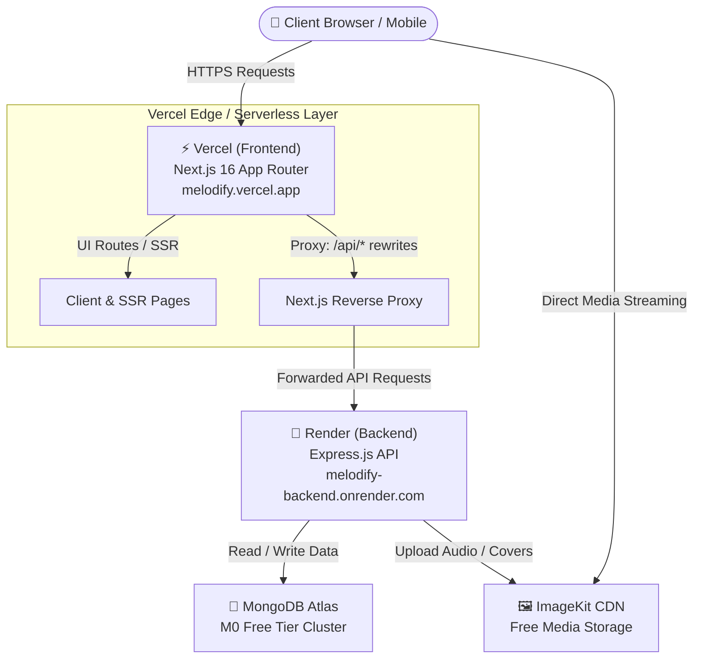

# 🚀 Melodify — Complete Free Deployment Guide

> **100% Free Production Deployment Guide for the Melodify Full-Stack Music Streaming Platform**  
> Covers **Render** (Backend), **Vercel** (Frontend), **MongoDB Atlas** (Database), **ImageKit** (Audio & Image CDN), plus top free alternatives (**Koyeb**, **Fly.io**, **Railway**, **Netlify**, **Cloudflare Pages**).

---

## 📑 Table of Contents

1. [Architecture & Zero-Cost Stack Overview](#1-architecture--zero-cost-stack-overview)
2. [Repository Structure & Pre-Deployment Checklist](#2-repository-structure--pre-deployment-checklist)
3. [Phase 1: Free Cloud Infrastructure (Database & Media CDN)](#3-phase-1-free-cloud-infrastructure-database--media-cdn)
   - [1.1 MongoDB Atlas (Free 512MB M0 Cluster)](#11-mongodb-atlas-free-512mb-m0-cluster)
   - [1.2 ImageKit (Free 20GB Audio/Image CDN)](#12-imagekit-free-20gb-audioimage-cdn)
4. [Phase 2: Deploy Backend to Render (Free Web Service)](#4-phase-2-deploy-backend-to-render-free-web-service)
5. [Phase 3: Deploy Frontend to Vercel (Free Hobby Tier)](#5-phase-3-deploy-frontend-to-vercel-free-hobby-tier)
6. [Phase 4: Understanding the Next.js API Proxy & Auth Cookies](#6-phase-4-understanding-the-nextjs-api-proxy--auth-cookies)
7. [Phase 5: Alternative Free Backend Platforms](#7-phase-5-alternative-free-backend-platforms)
   - [Alternative A: Koyeb (Free Eco Instance)](#alternative-a-koyeb-free-eco-instance)
   - [Alternative B: Fly.io (Free Allowance)](#alternative-b-flyio-free-allowance)
   - [Alternative C: Railway (Free Trial / Starter)](#alternative-c-railway-free-trial--starter)
   - [Backend Platform Comparison Matrix](#backend-platform-comparison-matrix)
8. [Phase 6: Alternative Free Frontend Platforms](#8-phase-6-alternative-free-frontend-platforms)
   - [Alternative A: Netlify (Free Starter Plan)](#alternative-a-netlify-free-starter-plan)
   - [Alternative B: Cloudflare Pages (Free Plan)](#alternative-b-cloudflare-pages-free-plan)
   - [Frontend Platform Comparison Matrix](#frontend-platform-comparison-matrix)
9. [Phase 7: Preventing Free-Tier Sleep / Cold Starts](#9-phase-7-preventing-free-tier-sleep--cold-starts)
10. [Phase 8: End-to-End Verification & Testing](#10-phase-8-end-to-end-verification--testing)
11. [Phase 9: Troubleshooting & FAQs](#11-phase-9-troubleshooting--faqs)

---

## 1. Architecture & Zero-Cost Stack Overview

Melodify is architected as a decoupled full-stack application: a **Next.js 16 (App Router)** client and an **Express.js (Node.js)** API server backed by **MongoDB** and **ImageKit**.



### Free Tier Breakdown (No Credit Card / Zero Cost)

| Layer | Recommended Tool | Free Allowance | Why It Fits Melodify |
|---|---|---|---|
| **Frontend** | **Vercel** | Unlimited deployments, 100 GB bandwidth, automatic SSL, Edge CDN | Native Next.js 16 support, Turbopack, zero-config reverse proxy rewrites |
| **Backend** | **Render** | 750 free instance hours/month, 512 MB RAM, free TLS certificates | Native Node.js deployment, automatic GitHub branch tracking |
| **Database** | **MongoDB Atlas** | 512 MB storage, shared RAM, automated patching | Industry-standard cloud MongoDB for user accounts and music metadata |
| **Media CDN** | **ImageKit** | 20 GB bandwidth/month, 20 GB media storage, real-time media transformations | High-speed global audio streaming and track thumbnail delivery |
| **Liveness Pinger** | **Cron-Job.org** or **UptimeRobot** | Free monitors up to every 5–10 minutes | Keeps Render backend awake to eliminate cold-start delay |

---

## 2. Repository Structure & Pre-Deployment Checklist

Melodify is organized as a monorepo containing distinct `backend` and `frontend` subdirectories under one Git repository:

```
Melodify/
├── backend/                  <-- Express.js API
│   ├── package.json
│   ├── server.js
│   ├── src/
│   │   ├── app.js
│   │   ├── controllers/
│   │   ├── db/
│   │   ├── models/
│   │   └── routes/
│   └── .env.example
├── frontend/                 <-- Next.js 16 App
│   ├── package.json
│   ├── next.config.js
│   ├── app/
│   ├── components/
│   ├── services/
│   └── .env.example
├── deployeGuide.md
└── .gitignore
```

> [!IMPORTANT]
> Because there is no root `package.json`, you **must specify the Root Directory** during deployment:
> - In **Render**: Root Directory = `backend`
> - In **Vercel**: Root Directory = `frontend`

### Commit & Push Your Latest Code to GitHub

Before beginning, ensure your local changes are committed and pushed to your remote GitHub repository:

```powershell
# 1. Check current status
git status

# 2. Stage all files (backend, frontend, configs)
git add .

# 3. Commit the changes
git commit -m "feat: complete melodify full-stack codebase ready for deployment"

# 4. Push to your main branch
git push origin main
```

---

## 3. Phase 1: Free Cloud Infrastructure (Database & Media CDN)

Before launching the backend, you must have cloud credentials for MongoDB and ImageKit.

---

### 1.1 MongoDB Atlas (Free 512MB M0 Cluster)

1. **Sign Up**: Go to [mongodb.com/cloud/atlas](https://www.mongodb.com/cloud/atlas) and sign up for a free account.
2. **Create Organization & Project**:
   - Name your project: `Melodify`.
3. **Deploy a Free Cluster**:
   - Select **M0 (Shared Cluster)** — labeled **Free Forever**.
   - Cloud Provider: **AWS** or **Google Cloud**.
   - Region: Select the region geographically closest to your target audience (e.g., `us-east-1` or `ap-south-1`).
   - Cluster Name: `MelodifyCluster`.
   - Click **Create Deployment**.
4. **Configure Database Access (User Credentials)**:
   - In **Security** > **Database Access**, click **Add New Database User**.
   - Authentication Method: **Password**.
   - Username: `melodify_admin`
   - Password: Click *Autogenerate Secure Password* or create a strong password (e.g. `Melo#Pass2026!x`). **Save this securely!**
   - Built-in Role: **Read and write to any database**.
   - Click **Add User**.
5. **Configure Network Access (Whitelisting IP)**:
   - In **Security** > **Network Access**, click **Add IP Address**.
   - Click **Allow Access from Anywhere** (`0.0.0.0/0`).
   - *Why?* Cloud providers like Render, Koyeb, and Vercel use dynamic outbound IPs. Restricting to a single IP will cause connection timeouts.
   - Click **Confirm**.
6. **Obtain Connection String**:
   - Go to **Database** > Click **Connect** on your cluster.
   - Select **Drivers** (Node.js).
   - Copy the connection URI:
     ```text
     mongodb+srv://melodify_admin:<password>@melodifycluster.xxxx.mongodb.net/melodify?retryWrites=true&w=majority
     ```
   - Replace `<password>` with your actual database user password.
   - Add the database name `melodify` before the `?` query parameter.

---

### 1.2 ImageKit (Free 20GB Audio/Image CDN)

Melodify uses ImageKit to handle song audio uploads and cover art.

1. **Sign Up**: Visit [imagekit.io](https://imagekit.io) and register for a free account.
2. **Access Developer Options**:
   - In the dashboard, navigate to **Developer Options** (or **API Keys**).
3. **Copy the 3 Keys**:
   - **Public Key**: e.g., `public_AbCdEf12345...`
   - **Private Key**: e.g., `private_GhIjKl67890...`
   - **URL-Endpoint**: e.g., `https://ik.imagekit.io/your_id/`

---

## 4. Phase 2: Deploy Backend to Render (Free Web Service)

Render allows you to host web servers directly from your GitHub repository with automatic TLS certificates.

### Step-by-Step Instructions

1. **Log in to Render**:
   - Go to [render.com](https://render.com) and log in with your **GitHub** account.
2. **Create New Web Service**:
   - From the Dashboard, click **New +** > **Web Service**.
   - Select **Build and deploy from a Git repository**.
   - Find and select your `Melodify` repository.
3. **Configure Service Details**:
   - **Name**: `melodify-backend` (creates `melodify-backend.onrender.com`)
   - **Region**: Select the region matching or close to your MongoDB Atlas region (e.g., *Singapore*, *Frankfurt*, *Oregon*).
   - **Branch**: `main`
   - **Root Directory**: `backend` ⚠️ *(DO NOT SKIP: specifies the backend folder)*
   - **Runtime**: `Node`
   - **Build Command**: `npm install`
   - **Start Command**: `npm start` (or `node server.js`)
   - **Instance Type**: Select **Free** ($0/month, 512 MB RAM, 0.1 CPU).
4. **Add Environment Variables**:
   Click **Advanced** > **Add Environment Variable** and add the following keys:

   | Key | Value | Example / Note |
   |---|---|---|
   | `NODE_ENV` | `production` | Enables production optimizations |
   | `PORT` | `5000` | Render injects this or defaults to 10000; our [server.js](file:///c:/Antigravity/backendNew/Melodify/backend/server.js) handles `process.env.PORT` |
   | `MONGO_URI` | `mongodb+srv://melodify_admin:...` | Your MongoDB Atlas connection string |
   | `JWT_SECRET` | `melodify_jwt_prod_secret_key_2026_xyz` | High-entropy random secret key |
   | `IMAGEKIT_PUBLIC_KEY` | `public_...` | From your ImageKit dashboard |
   | `IMAGEKIT_PRIVATE_KEY` | `private_...` | From your ImageKit dashboard |
   | `IMAGEKIT_URL_ENDPOINT`| `https://ik.imagekit.io/...` | From your ImageKit dashboard |

5. **Deploy**:
   - Click **Create Web Service**.
   - Render will clone the repo, navigate to `backend`, run `npm install`, and execute `npm start`.
   - Monitor the deployment logs. When ready, you will see:
     ```
     Connected to MongoDB
     Server running on port 5000
     Your service is live 🎉
     ```
6. **Verify the Backend**:
   - Open your service URL in the browser:  
     `https://melodify-backend.onrender.com/`
   - You should see the response:  
     `Melodify Backend is running 🚀`
   - **Copy this URL** — you need it for the frontend configuration in Phase 3.

---

## 5. Phase 3: Deploy Frontend to Vercel (Free Hobby Tier)

Vercel is the creator and optimal deployment platform for Next.js applications.

### Step-by-Step Instructions

1. **Log in to Vercel**:
   - Go to [vercel.com](https://vercel.com) and log in with your **GitHub** account.
2. **Import Repository**:
   - In the Vercel dashboard, click **Add New...** > **Project**.
   - Locate and click **Import** next to your `Melodify` repository.
3. **Configure Project Settings**:
   - **Project Name**: `melodify-music` (or `melodify`)
   - **Framework Preset**: `Next.js` (automatically detected)
   - **Root Directory**: Click **Edit** next to Root Directory and select `frontend`. ⚠️ *(CRITICAL!)*
   - **Build and Output Settings**:
     - *Build Command*: `npm run build` (Default)
     - *Output Directory*: `.next` (Default)
     - *Install Command*: `npm install` (Default)
4. **Configure Environment Variables**:
   Expand the **Environment Variables** section and add:

   | Key | Value | Description |
   |---|---|---|
   | `NEXT_PUBLIC_API_BASE_URL` | `https://melodify-backend.onrender.com` | Live Render backend URL (no trailing slash) |
   | `BACKEND_INTERNAL_URL` | `https://melodify-backend.onrender.com` | Used by Next.js rewrites in [next.config.js](file:///c:/Antigravity/backendNew/Melodify/frontend/next.config.js) |

5. **Deploy**:
   - Click **Deploy**.
   - Vercel will install dependencies, compile TypeScript, run the Next.js production build, and distribute the static assets across its global Edge CDN.
   - Once complete, you will be directed to the dashboard showing your production URL (e.g., `https://melodify-music.vercel.app`).
6. **Test the Live Website**:
   - Click your deployment domain to launch Melodify.

---

## 6. Phase 4: Understanding the Next.js API Proxy & Auth Cookies

A common issue when deploying decoupled frontend and backend apps across different domains (`melodify.vercel.app` vs `melodify-backend.onrender.com`) is **cross-origin cookie blocking** (Third-Party Cookie restrictions in Safari, Chrome, etc.).

### How Melodify Solves This

Melodify uses **Next.js Rewrites** configured in [frontend/next.config.js](file:///c:/Antigravity/backendNew/Melodify/frontend/next.config.js):

```javascript
// frontend/next.config.js
module.exports = {
  async rewrites() {
    const backendUrl = process.env.BACKEND_INTERNAL_URL || process.env.NEXT_PUBLIC_API_BASE_URL || 'http://localhost:3000';
    return [
      {
        source: '/api/:path*',
        destination: `${backendUrl}/api/:path*`,
      },
    ];
  },
};
```

### Why this is advantageous:
1. **Zero CORS Issues**: The client browser sends requests to its own domain (`https://melodify.vercel.app/api/auth/login`). To the browser, this is a **same-origin** request.
2. **First-Party Cookies**: When the backend responds with `Set-Cookie: Token=...`, the cookie is stored directly under `melodify.vercel.app`.
3. **Automatic Cookie Forwarding**: Subsequent calls from [frontend/services/api.ts](file:///c:/Antigravity/backendNew/Melodify/frontend/services/api.ts) with `credentials: 'include'` forward the `Token` cookie through Vercel's proxy to the Express backend without cross-origin friction.

> [!NOTE]
> If you ever decide to connect the frontend directly to the backend bypassing the proxy, you will need to add the `cors` package to `backend/src/app.js` with `credentials: true`, `origin: 'https://melodify.vercel.app'`, and configure cookie flags with `sameSite: 'none'` and `secure: true`. The existing Next.js proxy avoids this requirement.

---

## 7. Phase 5: Alternative Free Backend Platforms

If Render does not fit your requirements or if you want backup hosting options, here are the best free alternatives.

---

### Alternative A: Koyeb (Free Eco Instance)

[Koyeb](https://www.koyeb.com) provides micro-VMs running on bare-metal infrastructure with fast wake-up times.

#### Advantages:
- 1 free web service (Eco instance: 512 MB RAM, 0.1 vCPU).
- Fast cold starts (often 2–5 seconds, compared to 30–50 seconds on Render).
- Built-in global edge network with TLS.

#### Step-by-Step Deployment on Koyeb:
1. Sign up at [koyeb.com](https://www.koyeb.com) with GitHub.
2. Click **Create App**.
3. Select **GitHub** as the deployment source and select your `Melodify` repo.
4. In **Builder Configuration**:
   - Choose **Buildpack**.
   - Set **Workdir / Root Directory**: `backend`.
5. In **Environment Variables**:
   - Add `MONGO_URI`, `JWT_SECRET`, `IMAGEKIT_PUBLIC_KEY`, `IMAGEKIT_PRIVATE_KEY`, `IMAGEKIT_URL_ENDPOINT`, `NODE_ENV=production`.
   - Set `PORT` to `8000` (Koyeb's default HTTP port).
6. In **Instance Type**: Select **Eco (Free)**.
7. Click **Deploy**. Koyeb will provide a URL like `https://melodify-backend-yourname.koyeb.app`.

---

### Alternative B: Fly.io (Free Allowance)

[Fly.io](https://fly.io) converts your code into microVMs running on Firecracker across global regions.

#### Advantages:
- Generous free allowance (up to 3 shared-cpu-1x 256MB VMs).
- Ultra-low latency edge routing.

#### Step-by-Step Deployment on Fly.io:
1. Install Fly CLI (Windows PowerShell):
   ```powershell
   pwsh -Command "iwr https://fly.io/install.ps1 -useb | iex"
   ```
2. Log in:
   ```bash
   fly auth login
   ```
3. Navigate to the backend directory:
   ```bash
   cd backend
   ```
4. Initialize the Fly application:
   ```bash
   fly launch --no-deploy
   ```
5. Set environment variables securely via secrets:
   ```bash
   fly secrets set MONGO_URI="mongodb+srv://..." JWT_SECRET="your_secret" IMAGEKIT_PUBLIC_KEY="..." IMAGEKIT_PRIVATE_KEY="..." IMAGEKIT_URL_ENDPOINT="..."
   ```
6. Deploy:
   ```bash
   fly deploy
   ```
7. Fly provides your URL: `https://your-app-name.fly.dev`.

---

### Alternative C: Railway (Free Trial / Starter)

[Railway](https://railway.app) provides developer-friendly deployments with automated Nixpacks detection.

#### Advantages:
- Zero manual configuration.
- $5 free monthly credit (for trial/starter accounts).
- Instant GitHub sync.

#### Step-by-Step Deployment on Railway:
1. Go to [railway.app](https://railway.app) and sign in with GitHub.
2. Click **New Project** > **Deploy from GitHub repo** > select `Melodify`.
3. In service **Settings** > **Root Directory**, set to `/backend`.
4. In **Variables**, add all keys from your `.env` file.
5. In **Settings** > **Networking**, click **Generate Domain**.
6. Railway will automatically deploy and expose `https://melodify-backend-production.up.railway.app`.

---

### Backend Platform Comparison Matrix

| Feature | Render (Recommended) | Koyeb | Fly.io | Railway |
|---|---|---|---|---|
| **Free Tier Model** | 750 free hours/mo | 1 Free Eco microVM | Free resource allowance | $5 one-time/trial credit |
| **RAM (Free)** | 512 MB | 512 MB | 256 MB per VM | 512 MB – 8 GB |
| **Inactivity Sleep** | Sleeps after 15 min | Sleeps when idle | Sleeps if configured | Does not sleep while credit lasts |
| **Wake-up Latency** | ~30–50 seconds | ~3–5 seconds | ~1–3 seconds | Instant |
| **Setup Complexity** | Very Low (UI form) | Very Low (UI form) | Medium (CLI required) | Very Low |
| **Custom Domains** | Yes (Free SSL) | Yes (Free SSL) | Yes (Free SSL) | Yes (Free SSL) |

---

## 8. Phase 6: Alternative Free Frontend Platforms

While Vercel is the native home for Next.js, these alternatives offer free hosting with global distribution.

---

### Alternative A: Netlify (Free Starter Plan)

[Netlify](https://www.netlify.com) supports Next.js with their Next.js Runtime plugin.

#### Advantages:
- 100 GB monthly bandwidth.
- 300 build minutes/month.
- Automated branch previews and rollbacks.

#### Step-by-Step Deployment on Netlify:
1. Log in to [netlify.com](https://www.netlify.com) using GitHub.
2. Click **Add new site** > **Import an existing project**.
3. Select the `Melodify` repository.
4. Configure Build settings:
   - **Base directory**: `frontend`
   - **Build command**: `npm run build`
   - **Publish directory**: `frontend/.next`
5. Click **Add environment variables**:
   - `NEXT_PUBLIC_API_BASE_URL`: `https://melodify-backend.onrender.com`
   - `BACKEND_INTERNAL_URL`: `https://melodify-backend.onrender.com`
6. Click **Deploy Site**. Netlify automatically attaches the `@netlify/plugin-nextjs` and launches your site.

---

### Alternative B: Cloudflare Pages (Free Plan)

[Cloudflare Pages](https://pages.cloudflare.com) offers unlimited bandwidth across Cloudflare's Anycast network.

#### Advantages:
- **Unlimited bandwidth** (no 100GB cap).
- 500 builds per month.
- Fastest global DNS and CDN resolution.

#### Deployment Note for Next.js on Cloudflare:
Because Cloudflare runs on the V8 Edge runtime instead of standard Node.js:
1. For dynamic SSR routes, use `@cloudflare/next-on-pages`.
2. Alternatively, for static export, set `output: 'export'` in `next.config.js` and set the build output directory to `out`.

---

### Frontend Platform Comparison Matrix

| Feature | Vercel (Recommended) | Netlify | Cloudflare Pages |
|---|---|---|---|
| **Next.js 16 Support** | Day-0 native support | Supported via plugin | Requires Edge adaptation |
| **Free Bandwidth** | 100 GB / month | 100 GB / month | **Unlimited** |
| **Build Minutes** | 6,000 min / month | 300 min / month | 500 builds / month |
| **Serverless Functions** | Included | Included | Cloudflare Workers |
| **Custom Domains** | Unlimited free SSL | Unlimited free SSL | Unlimited free SSL |
| **Setup Simplicity** | 1-Click | 1-Click | Moderate |

---

## 9. Phase 7: Preventing Free-Tier Sleep / Cold Starts

Render's free tier spins down (sleeps) backend web services after **15 minutes of inactivity**. The next incoming request takes **30–50 seconds** to wake the instance up.

To keep your Melodify backend continuously responsive for users without paying anything, set up a free automated health-check pinger.

### Solution: Automated Cron Ping to `/`

Melodify's Express backend has a built-in root health-check endpoint in [backend/src/app.js](file:///c:/Antigravity/backendNew/Melodify/backend/src/app.js):
```javascript
app.get('/', (req, res) => {
    res.send('Melodify Backend is running 🚀');
});
```

### Method 1: Using Cron-Job.org (Recommended - 100% Free)

1. Register at [cron-job.org](https://cron-job.org/en/).
2. Click **Create Cronjob**.
3. **Title**: `Melodify Backend Keep-Alive`
4. **URL**: `https://melodify-backend.onrender.com/`
5. **Execution Schedule**: Select **Every 10 minutes** (or 14 minutes).
6. **Request Method**: `GET`
7. Click **Create**.
8. *Result*: Cron-job will send a lightweight HTTP ping every 10 minutes, keeping the Render free container warm and active 24/7.

### Method 2: Using UptimeRobot (Free Alternative)

1. Sign up at [uptimerobot.com](https://uptimerobot.com).
2. Click **Add New Monitor**.
3. Monitor Type: **HTTP(s)**.
4. Friendly Name: `Melodify Backend`.
5. URL: `https://melodify-backend.onrender.com/`.
6. Monitoring Interval: **Every 5 minutes**.
7. Click **Create Monitor**.
8. *Bonus*: In addition to preventing sleep, you receive email alerts if your backend ever experiences an issue.

---

## 10. Phase 8: End-to-End Verification & Testing

Once both the backend and frontend are live, run through this checklist to ensure all systems operate properly:

- [ ] **1. Health Check Endpoint**:  
  Navigate to `https://melodify-backend.onrender.com/` in your browser.  
  *Expected*: `Melodify Backend is running 🚀`.
- [ ] **2. Frontend Initial Load**:  
  Navigate to `https://melodify-music.vercel.app`.  
  *Expected*: Obsidian & neon dark-mode UI loads, hero section displays, and navigation works without console errors.
- [ ] **3. User Registration**:  
  Go to `/register`. Fill in username, email, and password.  
  *Expected*: Success toast/redirect, record created in MongoDB Atlas `users` collection, `Token` cookie stored.
- [ ] **4. User Login & Cookie Persistence**:  
  Log out and log back in at `/login`. Refresh the page.  
  *Expected*: User session persists; profile details show in header.
- [ ] **5. Audio & Artwork Upload**:  
  Log in as artist/admin or navigate to `/upload`. Upload an audio track (`.mp3`/`.wav`) and cover thumbnail.  
  *Expected*: Multipart form uploads to ImageKit; song record created in MongoDB Atlas `musics` collection.
- [ ] **6. Music Streaming Engine**:  
  Click **Play** on any uploaded song.  
  *Expected*: Audio stream loads from ImageKit CDN, play/pause controls toggle, progress bar advances, and global audio bar functions smoothly.

---

## 11. Phase 9: Troubleshooting & FAQs

### Q1: Render build fails with `Error: Cannot find module` or `package.json not found`
- **Cause**: Root Directory was not configured, causing Render to look at the repo root instead of `backend`.
- **Fix**: In Render > Service Settings > **Root Directory**, set to `backend` and trigger a manual redeploy.

### Q2: Vercel build fails with `npm error code ENOENT`
- **Cause**: Root Directory was not set to `frontend`.
- **Fix**: In Vercel > Project Settings > **General** > **Root Directory**, click **Edit**, choose `frontend`, and click **Save**. Redeploy under the **Deployments** tab.

### Q3: Backend fails with `MongooseServerSelectionError: connection timed out`
- **Cause**: MongoDB Atlas IP Whitelist does not allow access from Render's cloud servers.
- **Fix**: In MongoDB Atlas > **Network Access**, ensure `0.0.0.0/0` (Allow access from anywhere) is active.

### Q4: 401 Unauthorized errors on API calls after logging in
- **Cause**: The frontend is not sending the `Token` cookie to the backend.
- **Fix**: 
  1. Confirm your frontend is calling relative URLs (`/api/...`) so requests pass through the Next.js reverse proxy configured in `next.config.js`.
  2. Verify `BACKEND_INTERNAL_URL` in Vercel matches your Render backend URL without any trailing slash (e.g., `https://melodify-backend.onrender.com`).

### Q5: Uploads fail with `413 Payload Too Large` or ImageKit error
- **Cause**: The file exceeds upload size limits or ImageKit credentials are incorrect.
- **Fix**: Verify `IMAGEKIT_PUBLIC_KEY`, `IMAGEKIT_PRIVATE_KEY`, and `IMAGEKIT_URL_ENDPOINT` in Render environment variables. Keep song file sizes within typical web streaming limits (under 25MB for free tier).

---

## 🏁 Summary Checklist

```markdown
- [x] MongoDB Atlas M0 Cluster created (IP: 0.0.0.0/0)
- [x] ImageKit Account configured with 3 API keys
- [x] Code committed & pushed to GitHub main branch
- [x] Render Web Service deployed (Root Directory: backend)
- [x] Vercel Project deployed (Root Directory: frontend)
- [x] Environment variables configured on Render & Vercel
- [x] Uptime ping configured via Cron-Job.org (avoids spin-down)
- [x] Complete end-to-end user registration and audio streaming validated
```

*Your Melodify application is now deployed in production with high performance, automatic SSL, global CDN delivery, and zero recurring hosting costs!*
